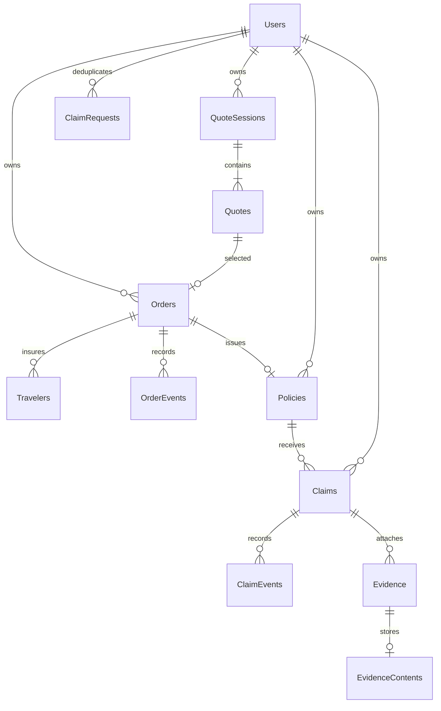

# Architecture and data model

```text
Browser (React / TypeScript / Tailwind / EN-DE-RU)
    → Next.js presentation on localhost:3001
    → same-origin /api/v1 forwarding
    → ASP.NET Core API on 127.0.0.1:5081
        → Identity / owner checks / domain validation
        → feature services / replaceable demo providers
        → EF Core → isolated PostgreSQL on127.0.0.1:55462
        → optional HttpClient → fixed Google Gemini API
```

Next.js serves UI and a public ECB reference-rate read. Fictional homepage examples are fixed read-only display data, without purchase IDs. Every actual quote, order, traveler save, payment state, policy, document, claim, upload and account operation is owned by C#. There is no TypeScript/Supabase business API fallback.

## Modules

- `backend/Domain`: DTOs/camelCase contracts, entities and trust-boundary/domain validation.
- `backend/Features`: cohesive Auth, Checkout, Policy, Claim, Operations and Assistant endpoints/services.
- `backend/Infrastructure`: EF mapping/projections, HTTP errors/origin guards, current owner, transactional mutation filter and demo payment/insurance adapters.
- `frontend/src/components` and `features`: feature UI, shared native/Base UI controls, policy examples, product previews and localization. Personal forms stay in owner-scoped memory until explicit server saving.
- `frontend/src/lib/contracts.ts`: browser API contract. C# mirrors it in Domain/Contracts.cs; interoperability is checked through HTTP/browser journeys.

## Relationships



Identity supplies its standard users/roles/claims/login/token tables. Core application records carry foreign keys and authoritative owner IDs. Travelers have unique `(OrderId, Position)`; order quote identity is unique, policy/order is one-to-one, and policy numbers are unique. Claim versions use `UpdatedAt` concurrency checking. Claim-create keys are unique per owner and bound to the canonical request payload.

Quote/trip/coverage/exclusion snapshots use JSONB because purchased terms must remain immutable and retain benefit scope, null-limit meaning, excess, conditions, EUR cents and terms version. Ownership, workflow statuses, relationships, traveler records, evidence and event history remain relational; the entire database is not a generic JSON CRUD store.

Evidence metadata contains owner, bound claim, attempt identity, digest, MIME, size and processing/tombstone state. Bytes are in a separate one-to-one table and never included in list/detail projections. Limits: PDF/JPEG/PNG signatures, 10 MB/file, ten files/claim. A requested owned file is read only after authorization. Deleting a draft cascades its attachment metadata/content; submitted claims are immutable to deletion. Bound idempotency/tombstone records prevent retries from attaching a different payload.

## Security and consistency

Identity hashes passwords and verifies credentials; the frontend never hashes/stores them. The cookie is separate from the original application and HttpOnly/SameSite=Lax; production requires Secure/HTTPS. Mutating requests require the configured frontend Origin. API failures use JSON rather than login redirects and private responses have no-store caching. Queries verify owner/role server-side; a contact email is never an ownership grant. Guest records transfer only from the currently protected guest session after successful registration or password validation, inside a transaction.

Short mutations run in PostgreSQL transactions under a demo-wide advisory lock with bounded database lock/statement waits. Uniqueness constraints plus durable order/policy state prevent double payment/issuance after duplicate requests. Unknown/pending payment-provider states reconcile through explicit reads/actions. This favors simple correctness at demo scale and is a documented throughput limitation.

A claim mutation/deletion carries the version reviewed by the UI; stale versions return409. Claim submission/resubmission validates current state and completeness. A client timeout does not prove failure; the UI rechecks records before offering retry. File attempt identity is owner/claim/digest-bound.

## Gemini boundary

The prompt is `docs/assistant-system-prompt.md`, embedded into the C# assembly. The model receives project facts and optionally a selected policy's benefit schedule after explicit consent and an owner-filtered query. It receives no system credentials or automatically attached identity/travel/medical/evidence data. User-written chat can still contain sensitive information, so the UI requests consent and warns against entering it.

The API key is a server environment secret passed in a header to the fixed Google endpoint; no client key or arbitrary URL/tool is accepted. Requests have time/output/body/concurrency/rate bounds and no automatic paid retries. Responses render as plain text; source destinations are constructed by the server and allowlisted by the browser. Prompt instructions guide model behavior but do not constitute a guarantee; ownership and data selection are enforced in code.
